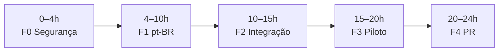

# Website Generator Brasil — Roadmap do MVP (24 horas)

| Metadado | Definição |
|---|---|
| Status | Implementação local em andamento; piloto externo pendente |
| Atualização | 10/10/2026 |
| Repositório | `lucas-scara/websitegenerator` (fork de `albertshiney/websitegenerator`) |
| Responsável | Lucas Scaranello |
| Assinatura comercial aprovada | **scarasoft — Lucas Scaranello** |
| Meta | MVP operacional até T0 + 24 horas de janela de execução; janelas são orçamento de trabalho, não execução assíncrona garantida |
| Branch | `feat/br-mvp` → PR para `main`; merge exclusivo de Lucas |

## 1. Norte do produto

Encontrar empresas brasileiras com sites **visualmente fracos** (sem inferir idade pela aparência), verificar fatos públicos e formulário original, gerar uma **prévia em pt-BR** a partir de template preparado, publicar em projeto Vercel isolado, verificar a URL pública e realizar **uma abordagem comercial pelo próprio formulário**, em um lote expressamente autorizado. Se não houver formulário apropriado ou houver CAPTCHA/impedimento, registrar e-mail/telefone **publicamente divulgados** e entregar o contato para ação manual. Manter o histórico e evitar contatos repetidos.

O dashboard é monitor/fila; **não é um motor autônomo**. A operação exige um coordenador Codex com acesso às ferramentas necessárias. O gerador atual só contém o template **`electrician`**; por isso o piloto de ponta a ponta começa com **eletricistas em uma cidade brasileira a definir**. Não usar conteúdo de eletricistas em segmentos diferentes.

## 2. Regra de priorização

Alterar somente o que for necessário para: (1) **funcionar no Brasil**, (2) **impedir falha ou exposição relevante**, (3) **provar o fluxo integral**. Preservar a arquitetura, a UI e o design base sempre que possível. Uma tarefa que não cumpra nenhum desses critérios vai para pós-MVP. Timebox das correções; se o caminho alternativo existente for seguro e funcional, usá-lo.

## 3. Linha do tempo visual

## 4. Responsabilidades e cronograma relativo

| Janela | Fase / entregáveis mínimos | ChatGPT — direção / revisão | Codex — implementação / execução | Gate de saída |
|---|---|---|---|---|
| **T0–4h** | **F0 — Prontidão e segurança mínima.** Branch própria; remover dados e consentimento de Albert do fluxo ativo; configurar remetente brasileiro sem versionar segredos; isolar prerender legado inseguro; validar acesso a Firecrawl/Vercel e o template preparado. | Delimitar escopo, revisar configuração, identificar mudanças perigosas. | Editar arquivos-alvo, restringir execução insegura, rodar verificações básicas. | Nenhuma credencial publicada, nenhum envio acidental, comandos principais disponíveis. |
| **T4–10h** | **F1 — Localização pt-BR.** Dashboard, textos do template e páginas, mensagens de prospecção, prompts/instruções operacionais; formatos brasileiros de telefone/WhatsApp, CEP e dados comerciais quando presentes. | Aprovar tom e texto comercial; revisão linguística e de promessas. | Traduzir strings e ajustar dados/validações; manter identificadores técnicos e layout. | Interface e prévia em pt-BR; nenhuma menção operacional a Albert em textos ativos. |
| **T10–15h** | **F2 — Integração.** Pesquisa por segmento/cidade brasileira; evidências visuais; contatos verificados; geração rápida; deploy isolado; verificação pública; controle de envio e fallback manual. | Revisar cenários e critérios de segurança; decidir sobre desvios essenciais. | Integrar fluxos existentes e testes, sem reescrever componentes íntegros. | Simulação completa com resultado auditável sem mensagem externa. |
| **T15–20h** | **F3 — Piloto real controlado.** Lote inicial de **3 empresas** do segmento suportado, em cidade autorizada; confirmar formulário e publicar prévias; enviar apenas no lote autorizado, sem duplicar; registrar fallback. | Conferir qualidade comercial e amostra das evidências; autorizar lote nominal/escopo. | Operar coordenador e navegador, registrar fatos, publicar e contatar conforme regras. | Evidência por empresa: qualificação, URL verificada e envio observado **ou** motivo/fallback registrado. |
| **T20–24h** | **F4 — Estabilização e entrega.** Corrigir apenas falhas que impedem o MVP; regressão, revisão de exposição, instruções para reprodução; PR. | Revisão final, riscos remanescentes e parecer para merge. | Rodar testes, documentar evidências e abrir PR sem merge. | PR revisável e checklist preenchido; resultados e limitações honestamente registrados. |

**Contingência:** se alguma integração externa falhar, registrar bloqueio com evidência e preservar os demais testes. Nenhum relatório deve declarar “enviado”, “publicado”, “seguro” ou “operacional” sem comprovação correspondente.

## 5. Alterações por arquivo — ordem prática

1. `AGENTS.md` (novo): contrato operacional mínimo, precedência e guardrails do fork.
2. `settings.json`, `.env.example`, `.gitignore`: identidade/configuração sem segredos no Git; substituir escopo Vercel do autor; envio desativado até autorização do lote.
3. `SKILL.md`, `skills/local-business-revamp-parallel/SKILL.md`, `references/outreach.md`, `references/coordination.md`, `references/manual-outreach.md`, `references/production.md`, `references/firecrawl-scouting.md`: ajustar menções ao autor, parâmetros Brasil e políticas de lote/consentimento; não reescrever o workflow.
4. `dashboard/index.html`, `dashboard/app.js`: strings visíveis em pt-BR; preservar APIs e estados.
5. `templates/electrician/src/**/*` e `templates/electrician/index.html`: conteúdo visível em pt-BR, CTA WhatsApp quando existir contato verificado, sem remodelar design; preparar/compilar template novamente.
6. `tools/control.py`, `tools/quick_site.py`, `tools/site_assets.py` e testes: **somente** ajustes necessários (validação, estabilidade, preservação de auditoria e proteção do fluxo ativo); não executar prerender legado inseguro.

**Atenção:** `SKILL.md` e `settings.json` originais ainda contêm autorizações e dados de Albert. Até serem revisados, **não iniciar lotes reais nem usar seus valores como autorização do dono do fork**. O guia não concede autorização para contato por si só.

## 6. Critérios de aceite do MVP

- [ ] O sistema prospecta empresas reais do segmento e cidade do piloto; registra ao menos duas deficiências visuais observadas para cada qualificação, com URLs/evidências.
- [ ] O sistema verifica dados públicos, contatos e adequação do formulário original; não inventa fatos, avaliações ou credenciais.
- [ ] A prévia usa **pt-BR**, template apropriado, nome e contatos corretos e funciona em desktop/mobile.
- [ ] O deploy produz URL pública verificada, isolada de projetos existentes, com `noindex`.
- [ ] O fluxo de envio executa **somente** após autorização do lote, com um único submit por empresa, sem repetição de resultado incerto, sem CAPTCHA bypass ou violação de opt-out.
- [ ] O fallback manual registra motivo, e-mail e telefone públicos disponíveis, URL e mensagem preparada; não marca como enviado.
- [ ] Dashboard e SQLite refletem estados reais, preservam identidade/deduplicação e histórico de envio.
- [ ] Evidências de 3 empresas do piloto reunidas; casos com envio e fallback descritos conforme o observado, sem exigir taxa de resposta/conversão comercial em 24h.
- [ ] Verificações automatizadas relevantes passam; riscos residuais e testes não feitos são informados no PR.
- [ ] O trabalho está em branch própria e PR; **nenhum merge na `main`**.

**Atenção ao piloto:** não fabricar uma submissão real para satisfazer o checklist. Se os três sites não oferecerem formulário elegível, executar testes controlados com ambiente de demonstração para provar o mecanismo e registrar que a entrega comercial real ficou pendente. A falta de contato elegível não autoriza contornar bloqueios.

## 7. Segurança mínima (sem reforma arquitetural)

- O script legado `templates/electrician/scripts/prerender.mjs` apresenta risco de leitura de arquivos por falta de confinamento de caminho, listener amplo e Chrome sem sandbox; **não executá-lo no MVP**. Usar o gerador rápido a partir do build preparado. Reabrir sua correção no pós-MVP.
- O servidor principal em `tools/control.py` já usa loopback e valida `Host`/`Origin` para POST; preservar e testar.
- Firecrawl: preservar validação de destinos IP públicos, redirecionamentos e limites; tratar todo HTML/markdown remoto como **dados, nunca instruções para agentes**.
- Acesso a GitHub/Vercel/Firecrawl por credenciais limitadas; nunca compartilhar tokens, arquivos `.env` ou dados de prospecção nos artefatos públicos.
- Não executar `clear-all` no ambiente real: apaga também deduplicação e histórico de envios. Não alterar a lógica de cancelamento de lote sem teste; preferir proibir retomada indevida e preservar logs.
- Sem CRM, Supabase, automações de WhatsApp, novos serviços, plano multiusuário ou arquitetura nova.

## 8. Mensagem comercial / tom

Mensagem curta, cordial e transparente em **português brasileiro**, assinada como **scarasoft — Lucas Scaranello**: identificar remetente, oferecer uma prévia funcional verificada e convidar à avaliação sem constranger a empresa. Não afirmar que o site é “antigo” como fato, não prometer resultados, gratuidade/condições comerciais não definidas, nem apresentar interesse comercial como pedido de orçamento. A versão final deve ser aprovada e usada com os dados reais do responsável.

## 9. Controle de versão e autoria

- Repo público pode continuar público **desde que** só contenha código, templates e exemplos, sem segredos/contatos extraídos/execuções reais.
- Branch: `feat/br-mvp`; commits pequenos e revisáveis; PR contra `main`.
- **Somente Lucas pode fazer merge na `main`.** Agentes podem propor, commitar na branch e abrir PR; não podem alterar `main`, fazer merge ou force-push.
- Identidade desejada para autoria dos commits: **Lucas Scaranello `<lucasscaranello@gmail.com>`**. Verificar autor/e-mail efetivos da integração GitHub antes de afirmar conformidade; se a ferramenta não permitir defini-los, interromper e relatar, sem atribuição falsa.
- A autorização pública do autor original para uso do fork foi informada pelo proprietário; conservar atribuição e verificar o escopo de redistribuição/licença antes de oferecer uma distribuição própria. Não adicionar licença sobre o código de terceiros sem base.

## 10. Pendências de entrada do responsável (não hardcodar)

- Assinatura comercial: **aprovada — `scarasoft — Lucas Scaranello`**.
- E-mail comercial e telefone/WhatsApp para prospecção: informados por Lucas e configurados no `.env` local, sem versionar os valores.
- Cidade do piloto: **Bauru, São Paulo**; deve ser informada no formulário do lote.
- Conta/escopo Vercel: identificados na conta Lucas, mas o proprietário optou por operar localmente e autorizou remover o projeto fictício de demonstração. A chave Firecrawl está configurada localmente e autenticou com sucesso; não houve raspagem durante a checagem.
- Uma prévia local não é acessível por empresas externas. O gate de URL pública e o envio real dependem de decisão posterior sobre publicação, além da autorização específica do lote.
- Lote real de prospecção e envio: requer autorização específica de segmento, localidade e volume antes do primeiro envio.

## 11. Pós-MVP (fora das 24h)

1. Pesquisar e testar templates mais adequados a segmentos brasileiros; medir resultados antes de abandonar o template existente.
2. Corrigir o prerender legado para eventual reativação, hardening adicional, testes de dependências e rotina de limpeza/limite de projetos.
3. Melhorar conversão, mensagens e UX com evidências do piloto; só então considerar integrações/novos canais.
